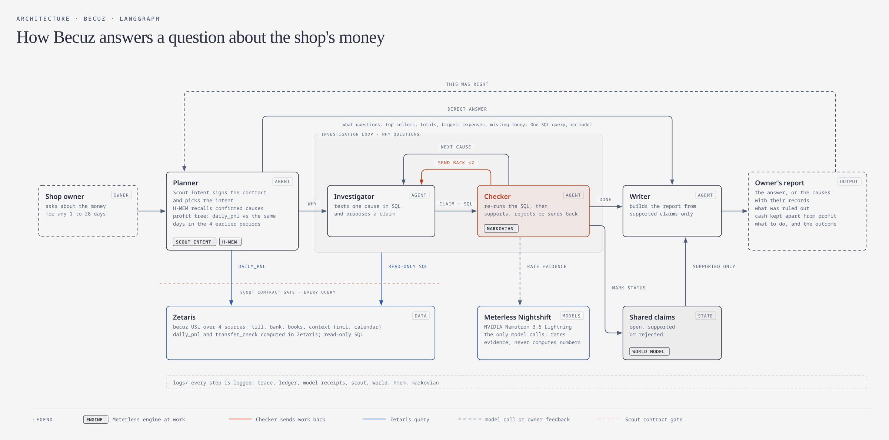
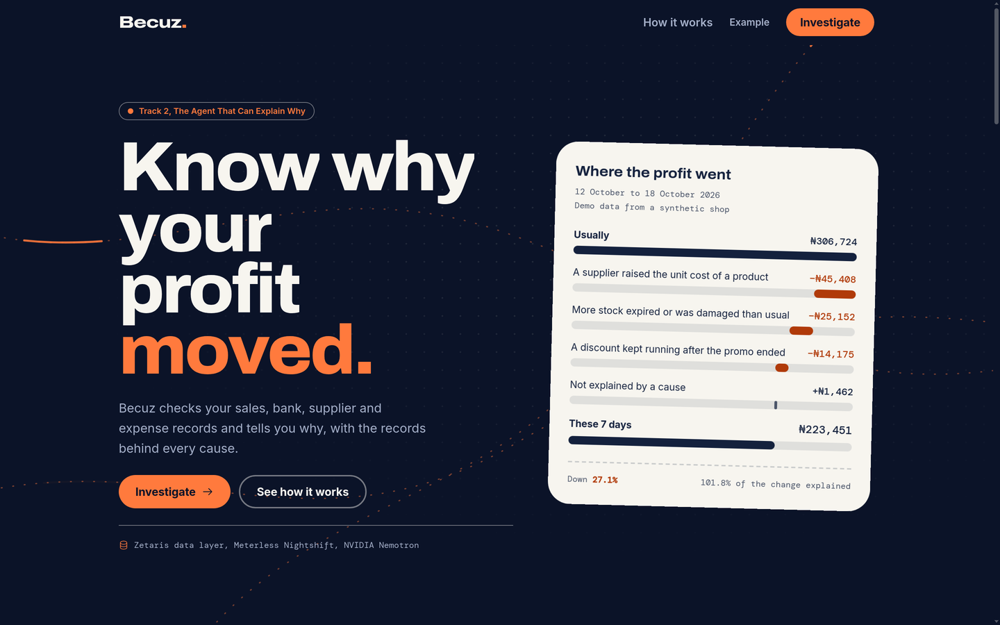
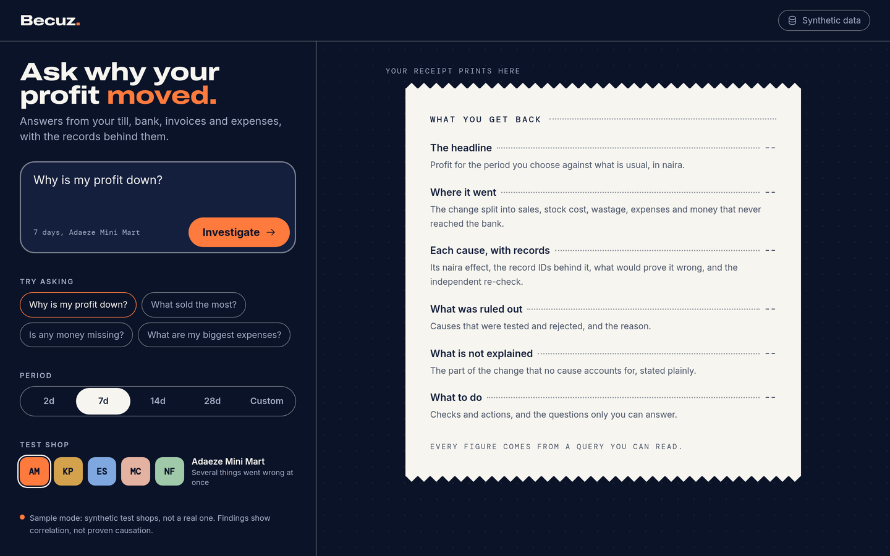
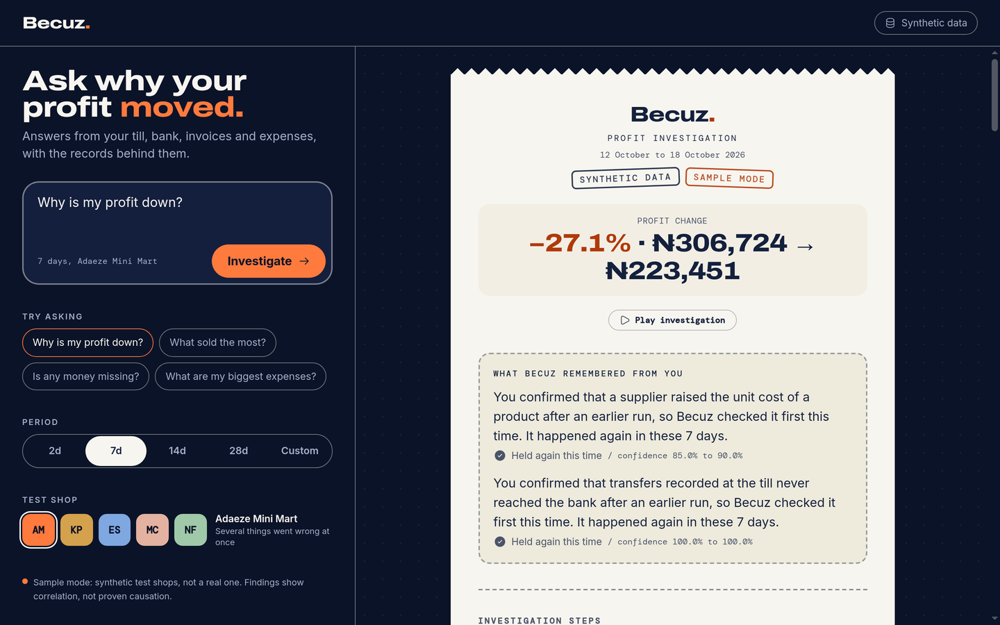
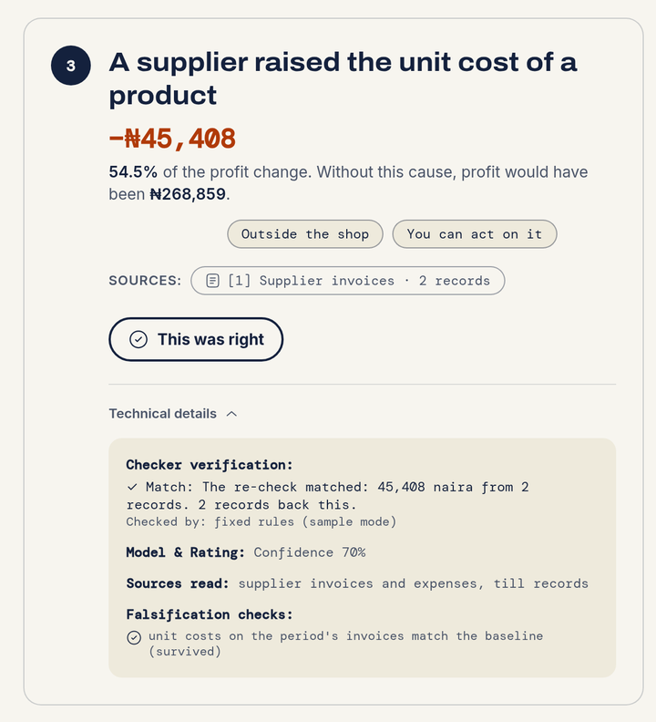
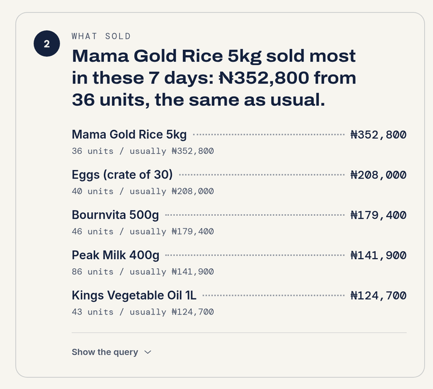

# Becuz

**Becuz tells a Nigerian mini-mart owner why their profit moved, in naira, with a receipt for every claim.**

> **Track 2:** The Agent That Can Explain Why, Open Agent Hackathon 2026
> **Sponsor technology:** Zetaris (data layer), Meterless Nightshift and four Meterless engines, NVIDIA Nemotron
> **Try it in two minutes:** [sample mode](#quick-start) needs no accounts, keys or network

[](docs/diagrams/architecture.png)

The owner asks a question about any 1 to 28 days, such as "Why is my profit down?". Becuz reads the shop's till
sales, bank statement, supplier invoices and expense book through Zetaris. It names each cause with its naira effect,
shows what it ruled out, and keeps missing money apart from profit. Every finding comes with a **receipt**: the SQL that
ran, the record IDs it found, and a second agent's independent re-run of that SQL.

SQL computes every naira figure. The model only rates the evidence and writes a note for the owner. It never
computes or changes a number.

## Contents

1. [Quick start](#quick-start)
2. [The problem](#the-problem)
3. [What Becuz returns](#what-becuz-returns)
4. [How it works](#how-it-works)
5. [Sponsor technology](#sponsor-technology)
6. [Web interface](#web-interface)
7. [API](#api)
8. [Live mode setup](#live-mode-setup)
9. [Examples and results](#examples-and-results)
10. [Source reliability and failure handling](#source-reliability-and-failure-handling)
11. [Logs and receipts](#logs-and-receipts)
12. [Safety](#safety)
13. [Data](#data)
14. [Configuration](#configuration)
15. [Tests](#tests)
16. [Tech stack](#tech-stack)
17. [AI and model usage](#ai-and-model-usage)
18. [Limitations](#limitations)
19. [Team and license](#team-and-license)

## Quick start

You need **Python 3.12** and [uv](https://docs.astral.sh/uv/). The web interface also needs **Node.js 20 or later**.

**1. Install**

```bash
git clone https://github.com/adr1en360/Becuz.git
cd Becuz
uv sync
cp .env.example .env          # Windows PowerShell: copy .env.example .env
```

**2. Run one investigation in sample mode** (offline, no accounts)

```bash
# macOS / Linux
SAMPLE_MODE=1 uv run python run.py --input input_examples/example_1.json
```

```powershell
# Windows PowerShell
$env:SAMPLE_MODE = "1"
uv run python run.py --input input_examples/example_1.json
```

This runs the whole investigation on the bundled synthetic shop and prints the report as JSON. See
[Sample mode](#sample-mode) for what it does and does not use.

**3. Open the web interface**

```bash
SAMPLE_MODE=1 uv run python server.py     # terminal 1: the agent on http://127.0.0.1:8000
cd web && npm install && npm run dev      # terminal 2: the web app on http://localhost:3000
```

On Windows, set `$env:SAMPLE_MODE = "1"` first, then run `uv run python server.py`. Open
<http://localhost:3000> and choose **Investigate**.

**Or use Docker** (sample mode only):

```bash
docker build -t becuz .
docker run --rm -p 8000:8000 becuz
curl -X POST http://127.0.0.1:8000/run -H "Content-Type: application/json" -d @input_examples/example_1.json
```

The image never contains `.env`. Live mode needs Nightshift running on your machine, so run it outside Docker.

## The problem

A mini-mart owner asks, "Why is my profit down?" The answer is spread across the POS till, the bank statement,
supplier invoices and the expense book, and nobody in the shop has time to join them by hand. Dashboards show that
profit fell; they do not say why, and they cannot prove it.

Becuz joins those records in place through Zetaris, tests each possible cause against them, and only names a cause
that a second agent has checked.

## What Becuz returns

**For a why-question** ("Why is my profit down?"), a full investigation:

- the period's profit against the same days in the 4 periods before it, moved back by whole weeks so busy and quiet
  weekdays line up
- ranked causes, each with its naira impact, its receipt and a confidence rating
- causes it tested and ruled out, with the reason
- how much of the change it explained, and how much is left unexplained
- **cash gaps, kept apart from profit:** transfers recorded at the till that never reached the bank. The sale
  happened, so it still counts as profit, but the money is missing
- causes the owner confirmed in earlier runs, and whether each one happened again
- one action per cause for the owner to take next

**For an everyday question**, a direct answer in seconds, from one read-only query with its records and no model
call:

| The owner asks | Becuz answers with |
|---|---|
| "What sold the most?" or "...the least?" | the top 5 products by naira, with units sold and the usual figure |
| "How much did I sell, make or spend?" | sales, cost of stock sold, wasted stock, running costs and profit, against usual |
| "What are my biggest expenses?" | spending by category, against usual |
| "Is any money missing?" | the transfer sales that never reached the bank, with their sale IDs |

Anything not about the shop's money gets a short reply with example questions.

## How it works

The diagram at the top shows the whole flow ([full size](docs/diagrams/architecture.png); its source is `docs/diagrams/architecture.html`). Four agents
share one LangGraph state. The claims themselves live in a shared World Model, so every agent sees the
same claims and every status change is kept.

| Agent | Responsibility | Can block or retry? |
|---|---|---|
| Planner | Opens a signed investigation contract, recalls causes the owner confirmed before, measures the profit tree, and orders the causes to test | Yes: refuses questions outside the contract |
| Investigator | Measures one cause with its SQL template through Zetaris and proposes a claim with its record IDs | Yes: re-tests a claim the Checker sends back |
| Checker | Re-runs the claim's SQL itself, then supports, rejects or sends it back. Asks Nemotron to rate the supported and rejected claims | Yes: sends a claim back up to 2 times, then rejects it |
| Writer | Builds the report from supported claims only. The report schema re-checks that every figure adds up | Yes: an invalid report fails instead of being returned |

### What makes this an agent system

- The Checker does not trust the Investigator. It re-runs the SQL and compares the result to ±₦1.
- A mismatch goes back to the Investigator for a re-test, up to 2 times.
- A claim is rejected when its loss is below ₦1,000, when no records back it, or when it is not a loss.
- A cause the owner confirmed in an earlier run is tested first next time. If it fails, its memory loses confidence
  and is flagged for review.
- A Zetaris timeout, network error, server error or Zetaris internal fault retries only the query that failed, up to
  5 attempts with waits of 10, 20, 40 and 40 seconds (about two minutes, enough for the Zetaris Spark session to
  restart). Each retry is written to the trace by the agent that hit it.
- The Checker hands each model rating to a background worker and moves on to the next cause. One worker keeps the
  Markovian chain in order, and the Writer waits for every rating before the report.
- A run stops after 60 steps.
- Every decision goes to a per-run trace with the agent, target agent, confidence, retry count and status.

## Sponsor technology

### Zetaris: where the shop's data is joined and checked

The four sources (POS, bank, books and context) are CSV files in S3, registered as Lightning databases. A Unified
Semantic Layer (USL) named `becuz` declares the shop's 12 tables and their keys. Two of them do work inside Zetaris:

- `daily_pnl` computes the profit tree for each day: sales minus cost of goods, wastage and expenses. It also keeps
  the day's missing transfers in their own column, outside profit.
- `transfer_check` matches each transfer sale to a bank credit.

The data-quality rule `transfer_reached_bank` runs on the same match. The agent connects as a non-admin user with
`SELECT` on the USL only, so Zetaris itself refuses any write or raw-source read.

### Meterless Nightshift and NVIDIA Nemotron: every model call

The Checker asks for `meterless/judge`, and Nightshift routes it to an NVIDIA Nemotron model. Each call is recorded
with the model that answered it and its Nightshift receipt ID.

| Agent | Nemotron model | What it does | Calls per run |
|---|---|---|---|
| Checker | `nvidia/nemotron-3.5-lightning-30b-a3b` (asked for as `meterless/judge`; both Nightshift lanes run it) | Rates the evidence for each supported or rejected claim and writes a note for the owner | One per tested cause on why-questions (6 on `s01`), plus retries; none on direct answers |
| Planner, Investigator, Writer | none | SQL only; they never call a model | 0 |

Both Nightshift lanes (Race and Judge) run Nemotron 3.5 Lightning. **Proof from a real live run:**

- [`output_examples/live_s01_receipts.jsonl`](output_examples/live_s01_receipts.jsonl): one `model` line per call with
  the model that answered and its request ID, and one `model_receipt` line per call once Nightshift signed it
- [`live_s01_output.json`](output_examples/live_s01_output.json) and
  [`live_s01_trace.jsonl`](output_examples/live_s01_trace.jsonl): the report and trace from the same run
- [`live_s01_queries.jsonl`](output_examples/live_s01_queries.jsonl): its 27 Zetaris queries against the `becuz` USL

Your own runs write the same log to `logs/ledger.jsonl`; run `uv run python verify_receipts.py` to add the signed
receipts.

### Four Meterless engines, implemented in `becuz/engines/`

| Engine | What it does in Becuz | Log |
|---|---|---|
| Scout Intent | Turns the question into a signed contract: one of 5 intents (the investigation, or a direct answer for top sellers, totals, expenses or missing money), the 10 tables the agent may read, a budget of 80 queries, and a 5-minute expiry. Every query passes through the contract | `logs/scout.jsonl` |
| World Model | The shared list of claims. Each verdict is a new status edge, so a claim's full history is kept | `logs/world.jsonl` |
| H-MEM | Remembers causes the owner confirmed and how they were found. They are recalled and tested first in later runs | `logs/hmem.json`, `logs/hmem.jsonl` |
| Markovian | Runs the Checker's model calls as a chain. Each call carries one short summary of earlier verdicts instead of the whole history, so every call stays the same size | `logs/markovian.jsonl` |

Each engine has its own tests in `tests/` (see [Tests](#tests)).

### What makes our sponsor use different

A common integration puts the data in a warehouse and asks a model for the answer. Becuz splits the work the other way:

1. **Zetaris computes, the model judges.** The profit tree (`daily_pnl`) and the transfer-to-bank match
   (`transfer_check`) are computed inside the Zetaris semantic layer. Nemotron only rates evidence it can see, so it
   cannot invent a figure.
2. **Two locks on the data.** Our own read-only SQL check runs first, and the agent's Zetaris user has `SELECT` on the
   USL only, so Zetaris itself refuses any write or raw-source read.
3. **The engines are the product, not a side demo.** Scout Intent gates every query, the World Model holds every claim
   and keeps the rejected ones, so the owner sees what was ruled out and why. H-MEM makes the owner's confirmations
   change the next run, and Markovian keeps each Checker call the same size.
4. **Every model rating is traceable.** The trace names the model that answered each call, and the ledger keeps a
   signed Nightshift receipt per call.

## Web interface

`web/` holds the owner-facing app: a Next.js site that renders the report JSON and computes nothing itself.

| Page | What it is |
|---|---|
| `/` | The landing page. Its figures come from a saved sample run (`web/src/data/example-s01.json`), labelled as demo data |
| `/investigate` | Ask a question, choose a period (2, 7, 14 or 28 days, or a custom start date) and, in sample mode, a test shop. The receipt prints on the right |

What the report shows, step by step: the question and period; where the money went; each cause with its source chips,
its records, the Checker's re-check and a **This was right** button that stores it in H-MEM; what was ruled out;
missing money; how much is explained; then a summary with what to do, the measured outcome, an Export PDF button and
the run facts. While a run is going, each agent step appears in plain words as it happens, and **Play investigation**
replays the steps afterwards.



| | |
|---|---|
|  |  |
|  |  |

All screenshots are from sample mode; see [`docs/screenshots/`](docs/screenshots/README.md). To run, build or
regenerate the web types from the schema, see [`web/README.md`](web/README.md).

## API

Start the server on `127.0.0.1:8000` with `uv run python server.py` (add `SAMPLE_MODE=1` for sample mode).

| Route | Returns |
|---|---|
| `POST /run` | Runs the investigation and returns the report as JSON. `400` with a message for a bad request |
| `POST /runs` | Starts the investigation in the background and returns `202` with its `run_id` at once. Use this for a live run, which takes minutes |
| `GET /runs/<run_id>` | The run's `status` (`running`, `complete` or `failed`), its trace `events` so far, and the `report` once complete |
| `POST /confirm` | `{"run_id": "...", "cause_id": "..."}`: the owner confirms a supported cause, and H-MEM stores it for the next run |
| `GET /health` | Whether sample mode is on and which providers are configured |

**Request:**

```json
{
  "question": "Why is my profit down?",
  "days": 7,
  "scenario": "s01"
}
```

`question` is required. `days` (1 to 28, default 7) sets the period's length, and `period_start` (like `2026-10-12`)
its first day; without it Becuz takes the latest days in the data. A period without 4 earlier periods of records is
refused with a plain message. `scenario` (`s01` to `s05`) applies to sample mode only.

<details>
<summary><b>Example response (abridged)</b></summary>

**Response (abridged, from `output_examples/example_1_output.json`):**

```json
{
  "status": "complete",
  "mode": "sample",
  "headline": {"current_ngn": 223450.94, "baseline_ngn": 306723.56, "change_ngn": -83272.62, "change_pct": -27.1},
  "causes": [
    {
      "rank": 1,
      "cause_id": "supplier_cost_rise",
      "title": "A supplier raised the unit cost of a product",
      "impact_ngn": -45408.0,
      "confidence": 0.7,
      "evidence": [{
        "table": "becuz.supplier_invoices",
        "sql": "SELECT ROUND(-COALESCE(SUM(CASE WHEN x.period_cost > x.period_qty * x.base_cost ...",
        "row_ids": ["INV-01158", "INV-01185"],
        "value_ngn": -45408.0,
        "check": {"match": true, "rerun_value_ngn": -45408.0, "via": "sample-rules"}
      }]
    }
  ],
  "cash_gaps": [
    {"cause_id": "transfer_leakage", "title": "Transfers recorded at the till never reached the bank",
     "impact_ngn": -18200.0, "evidence": [{"table": "becuz.transfer_check", "row_ids": ["SL-10924", "SL-10957", "..."]}]}
  ],
  "ruled_out": [{"cause_id": "pos_charge_rise", "reason": "The records show no loss from this cause in this period."}],
  "convergence": {"explained_ngn": -84735.0, "explained_pct": 101.8, "unexplained_ngn": 1462.38},
  "summary": {
    "what_happened": "Profit in these 7 days was ₦223,451, which is ₦83,273 less than usual (₦306,724).",
    "why": ["A supplier raised the unit cost of a product. This cost you ₦45,408.", "..."],
    "cash": ["₦18,200 from 6 transfer sales was recorded at the till but never reached the bank. The sales still count toward your profit, but this money is missing from your account."]
  },
  "stats": {"zetaris_queries": 27, "model_calls": 0, "retries": 0}
}
```

</details>

The full contract is in [`docs/investigation.schema.json`](docs/investigation.schema.json).

### Confirming a cause

After a run, the owner can confirm a cause it found, from the web interface (**This was right**) or the command line:

```bash
uv run python run.py --confirm <run_id> transfer_leakage
```

<details>
<summary><b>How memory works, from the command line</b></summary>

Only a cause the Checker supported in that run can be confirmed. H-MEM stores it, and the next run tests it first and
reports what happened in `memory`. To see it end to end in sample mode:

```bash
export SAMPLE_MODE=1                                              # Windows: $env:SAMPLE_MODE = "1"
uv run python run.py --input input_examples/example_2.json       # note the run_id
uv run python run.py --confirm <run_id> transfer_leakage
uv run python run.py --input input_examples/example_1.json
```

```json
"memory": [{
  "cause_id": "transfer_leakage", "held_again": true, "confidence_before": 0.7, "confidence_after": 0.75,
  "message": "You confirmed that transfers recorded at the till never reached the bank after an earlier run, so Becuz checked it first this time. It happened again in these 7 days."
}]
```

If a remembered cause does not happen again, its memory loses confidence and is flagged for review.

</details>

## Live mode setup

Live mode queries Zetaris and rates evidence with NVIDIA Nemotron through Nightshift. It needs a Nightshift install with
your NVIDIA key, the shop data in S3, and a Zetaris instance with a read-only agent user. Check every connection with
`uv run python smoke.py`.

<details>
<summary><b>Step-by-step live setup: Nightshift, S3 and Zetaris</b></summary>

Fill in `.env`, which is in `.gitignore`.

1. **Nightshift.** Install and start Meterless Nightshift, then add your NVIDIA key in its Providers tab. The NVIDIA
   key never goes in `.env`. On Windows, Becuz reads the Nightshift token from
   `%LOCALAPPDATA%\ai.meterless.runtime\proxy-token`; elsewhere, set `METERLESS_RUNTIME_TOKEN`. Then seat two cloud
   lanes in **Lanes**:
   - a **Race** lane with `nvidia/nemotron-3.5-lightning-30b-a3b` (for example the job "Extract structured data"). It
     answers the Checker's ratings. Without any lane, Nightshift falls back to its own routing and ignores the model
     Becuz asks for.
   - a **Judge** lane with the same `nvidia/nemotron-3.5-lightning-30b-a3b` ("Score different answers"). Nightshift
     keeps one non-racing judge in every setup; Becuz asks for `meterless/judge`, and on 27 Oct both lanes answered
     with Lightning, so we seat Lightning in both.
2. **Shop data in S3.** Upload one scenario's CSVs to `s3://<bucket>/becuz/<scenario>/`, without `answer_key.json`:

   ```bash
   aws s3 cp data/scenarios/s01 s3://<bucket>/becuz/s01/ --recursive --exclude answer_key.json
   ```

3. **Zetaris, as admin.** Set `ZETARIS_REST_URL`, `ZETARIS_ORG_ID`, `ZETARIS_ADMIN_API_KEY`, `S3_BUCKET`,
   `AWS_REGION`, `AWS_ACCESS_KEY_ID` and `AWS_SECRET_ACCESS_KEY`. Each script prints its statements first and sends
   nothing until you add `--apply`:

   ```bash
   uv run python -m scripts.zetaris_setup s01            # dry run
   uv run python -m scripts.zetaris_setup s01 --apply    # register the 4 sources and 10 tables
   uv run python -m scripts.zetaris_usl --apply          # build the becuz USL and its data-quality rule
   ```

   If a statement fails, fix the cause and resume with `--apply --start <n>`.
4. **Zetaris, agent user.** Create a non-admin user, grant it `SELECT` on the `becuz` USL in Access Control, and put
   its key in `ZETARIS_API_KEY`.

Then check every connection:

```bash
uv run python smoke.py
```

```text
config   PASS  zetaris=ok nightshift=ok
zetaris  PASS  daily_pnl up to 2026-10-18 via=zetaris
model    PASS  via=nightshift model=nvidia/nemotron-3.5-lightning-30b-a3b
agent    PASS  sample s01: 3 cause(s) supported
```

Then run `uv run python run.py --input input_examples/example_1.json`, or start the server and the web interface as
in the [Quick start](#quick-start) without `SAMPLE_MODE`.

</details>

### Sample mode

**Judges can run all of Becuz in sample mode, with no accounts, keys or network.** Every sample-mode run does the real
work again; nothing is replayed.

`SAMPLE_MODE=1` runs the full investigation with an empty `.env` and no network. The same Spark SQL runs on DuckDB over
the scenario's CSVs: the USL tables, including `daily_pnl` and `transfer_check`, are built locally from the same
activation queries Zetaris runs. The Checker's rating comes from fixed rules instead of a model, and the report and
trace label it `sample-rules`. Nothing is read from `output_examples/`.

## Examples and results

| Input | Scenario | What the agent finds |
|---|---|---|
| `input_examples/example_1.json` | `s01`: three planted profit causes and missing transfers | 3 profit causes and an ₦18,200 cash gap; fewer items sold and POS charges ruled out |
| `input_examples/example_2.json` | `s04`: missing transfers only | Profit did not fall, but ₦25,670 in transfers never reached the bank; every profit cause ruled out |
| `input_examples/example_3.json` | `s05`: nothing wrong | Nothing to fix; every cause ruled out |
| `input_examples/example_4.json` | `s01`, a direct question: "What sold the most?" | Mama Gold Rice 5kg, ₦352,800 from 36 units; no investigation, no model call |
| `input_examples/example_5.json` | `s01` over 14 days | Profit ₦78,611 below usual; the same 3 causes |

Each output and its trace are in `output_examples/`, saved from real sample-mode runs. The live run of `s01` through
Zetaris and Nightshift is saved too (`live_s01_*`, 27 Oct): it returned the same findings and naira figures as sample
mode. Nightshift's provider failed 10 of 13 rating calls that morning, so 3 causes carry a Nemotron 3.5 Lightning
rating with a signed receipt, and the report says the other 3 could not be rated while their SQL checks still stand.

### Scorecard

The scorecard runs all five test scenarios in sample mode and checks the findings against each answer key:

```bash
uv run python -m becuz.eval
```

```text
week       found  impact ok  herrings out  not planted
s01       4 of 4       4 of 4         1 of 1   -
s02       1 of 1       1 of 1         1 of 1   -
s03       2 of 2       2 of 2         1 of 1   -
s04       1 of 1       1 of 1         2 of 2   -
s05       0 of 0       0 of 0         1 of 1   -
total  8 of 8 planted causes found; 6 of 6 red herrings ruled out; 0 finding(s) not planted
```

"Impact ok" means within the key's 10% tolerance.

## Source reliability and failure handling

### Source reliability

Measured on the live `s01` run of 27 Oct, from its query log
([`live_s01_queries.jsonl`](output_examples/live_s01_queries.jsonl)):

| Source in Zetaris | What Becuz reads | Live run, 27 Oct | Status |
|---|---|---|---|
| POS till (`pos_files`) | `sales`, `sale_lines`, `promos`, `products`, `stock_movements` | Every query answered; median 1.7 to 9.8 s per table; one product join took 45 s | Verified |
| Bank (`bank_files`) | `bank_statement`, and `transfer_check` in the USL | Every query answered; `bank_statement` about 1.7 s; one `transfer_check` query took 44 s | Verified |
| Books (`books_files`) | `supplier_invoices`, `expense_book` (through `daily_pnl`) | Every query answered; `supplier_invoices` median 10.1 s; the slowest query of the run took 51 s | Verified |
| Context (`context_files`) | exchange rates and the calendar (through `daily_pnl`) | Read inside `daily_pnl`, median 8.6 s | Verified |
| Meterless Nightshift | Nemotron ratings for the Checker | 3 of 13 rating calls answered; the rest failed at the provider (`provider_deadline`) | Flaky that morning |

All 27 Zetaris queries succeeded with no retry: median 4.1 s, fastest 1.5 s, slowest 51.4 s, about 260 s in total. The
Nightshift failures did not change any figure: the report kept the SQL verdicts and said in `limitations` that 3 of 6
causes could not be rated.

### Caching

Becuz keeps no result cache of its own. Every run queries the records in place, so a figure is never older than the
records it came from. Speed comes from the shape of the work instead: `daily_pnl` and `transfer_check` are computed
inside Zetaris, queries are aggregated, and they run one at a time so the small cluster is not overloaded. Most queries
took 1.5 to 10 s; the slow ones were the first heavy queries of the session and the larger joins (44 to 51 s). Sample
mode builds the same tables in DuckDB in memory and finishes a run in about a second.

### Failure handling

<details>
<summary><b>Every failure and how Becuz handles it</b></summary>

| Failure | Behaviour |
|---|---|
| Zetaris timeout, network error, HTTP 5xx, or Zetaris internal fault (`Could not create ResultSet`, `TTransportException`, which Zetaris engineering traced to the Spark session restarting on a small cluster) | That query is retried, up to 5 attempts over about two minutes, with a `retry_query` line in the trace. Queries run one at a time with a 180 s timeout. The ledger records each query's `query_id` and `duration_ms` |
| Zetaris refuses a query | The run stops with an error. It is not retried |
| A re-check does not match the claim | The Checker sends it back. After 2 retries it is rejected |
| Data missing for a cause | The cause is listed as not tested, never read as zero |
| Nightshift fails or returns an unusable reply | Two retries, waiting 5 s after a rate limit or a provider failure. Then the SQL verdict stands, the confidence is empty, and the report adds one plain line to `limitations` |
| A question outside the contract | `400` with a plain reply and example questions: "Becuz explains what happened to your shop's money: profit, sales, costs, expenses and cash. Try …" |
| Malformed input | `400` with a validation message |
| Query budget used up, or contract expired | The query is refused; an expired contract is re-issued and linked to the first |
| A run that loops | Stopped after 60 steps |

</details>

## Logs and receipts

The app creates `logs/` on first write.

<details>
<summary><b>What each log file holds</b></summary>

- `logs/trace-<run_id>.jsonl` has one line per agent decision, also printed to stderr. Each line has `timestamp`,
  `run_id`, `agent_name`, `action`, `input_summary`, `output_summary`, `target_agent`, `confidence`, `retry_count` and
  `status`, plus the engine, model and route where they apply.
- `logs/ledger.jsonl` has one line per Zetaris query, model call or error, with the model that answered and its
  Nightshift request ID. Nightshift signs its receipt after the call returns. Once it settles, run
  `uv run python verify_receipts.py`, which adds a `model_receipt` line for each signed request.

</details>

## Safety

- Every SQL statement passes a read-only check first: `SELECT`, `WITH`, `SHOW`, `DESCRIBE` and `EXPLAIN` only.
  Multiple statements, unreadable quoting, Spark functions that run Java and script transforms are rejected.
- The agent's Zetaris user can read only the `becuz` USL. Only the setup scripts use the admin key.
- The model is told to treat record text as data, never as instructions, and its reply is used only as a rating and a
  note.
- Logs redact key patterns before writing. `.env` is never committed.
- No model weights are downloaded and no local GPU is needed.

## Data

All shop data is synthetic, generated from a fixed seed by `data/generator.py`. No real shop, customer or bank data is
used. See [`data/README.md`](data/README.md) for the five scenarios. In the web interface they appear as five fictional
test shops.

<details>
<summary><b>Mapping a shop’s own CSV exports (offline preparation)</b></summary>

**Uploads of any shape (offline preparation, not part of a live run yet).**
`uv run python -m becuz.ingest <upload_dir> <out_dir>` reads a shop's own CSV exports, whatever their file and column
names, maps them onto the records Becuz uses, and writes them in the shape `data/scenarios` uses. It blocks the mapping
when the figures do not reconcile (for example, sale lines that do not add up to the sale) or when a payment type is
unknown, and says which records are missing. `data/uploads/s06` is a test upload with different names and no stock
file; `tests/test_ingest.py` covers it.

</details>

## Configuration

<details>
<summary><b>All settings</b></summary>

`.env.example` lists every setting with placeholder values.

| Variable | Default | Purpose |
|---|---|---|
| `ZETARIS_REST_URL` | none | Zetaris REST base: `https://api.<cluster-id>.cloud.zetaris.com/api/v1.0` |
| `ZETARIS_ORG_ID` | none | Zetaris organisation ID, a number |
| `ZETARIS_API_KEY` | none | The agent user's key |
| `ZETARIS_ADMIN_API_KEY` | none | Admin key, used only by the setup scripts |
| `S3_BUCKET`, `AWS_REGION`, `AWS_ACCESS_KEY_ID`, `AWS_SECRET_ACCESS_KEY` | none | Used only by `scripts.zetaris_setup` |
| `METERLESS_BASE_URL` | `http://127.0.0.1:8088/v1` | Nightshift endpoint |
| `METERLESS_RUNTIME_TOKEN` | read from the Nightshift token file | Override for the Nightshift token |
| `LEDGER_PATH` | `logs/ledger.jsonl` | Event ledger; `none` turns it off |
| `TRACE_PATH` | `logs/trace.jsonl` | Traces and engine logs go in this file's folder; `none` turns them off |
| `SAMPLE_MODE` | `0` | `1` runs offline on the bundled shop data |
| `SERVER_HOST`, `SERVER_PORT` | `127.0.0.1`, `8000` | Server address |

The web app reads one setting, `NEXT_PUBLIC_API_URL` (default `http://127.0.0.1:8000`).

</details>

## Tests

The tests run offline and need no credentials.

```bash
uv run python -m unittest discover -s tests -p "test_*.py"
```

<details>
<summary><b>What the tests cover</b></summary>

They cover the generator, the SQL templates against the answer keys, the read-only guard, the report schema, the
server, and the four engines. The H-MEM, World Model and Markovian tests port the Meterless conformance cases by ID;
the Scout Intent tests check the rules in its spec, which has no conformance suite. `BECUZ_LIVE=1` adds a test that
compares the profit tree from live Zetaris with sample mode. The [scorecard](#scorecard) checks the findings against
the answer keys.

For the web app: `cd web && npm run lint && npm run build`.

</details>

## Tech stack

| Component | Technology |
|---|---|
| Language | Python 3.12, managed with uv |
| Orchestration | LangGraph |
| Data access | Zetaris REST API and USL |
| Model runtime | Meterless Nightshift |
| Models | NVIDIA Nemotron, through Nightshift |
| Report contract | Pydantic, exported to `docs/investigation.schema.json` |
| Sample mode | DuckDB, with the same Spark SQL translated by sqlglot |
| API | Standard-library HTTP server (`server.py`) |
| Web interface | Next.js, React, Tailwind CSS, Solar icons |
| Logging | JSONL in `logs/` and stdout |
| Container | Docker, sample mode |

## AI and model usage

**Models (through Meterless Nightshift):**
- `nvidia/nemotron-3.5-lightning-30b-a3b`: the Checker's rating of each tested claim and its note for the owner. Every
  call and its signed receipt is logged (`output_examples/live_s01_receipts.jsonl`).
- No model computes a number, chooses SQL or writes the summary. SQL computes every figure.

**Agent framework:** LangGraph (four agents in one graph).

**Sponsor technology:** see [Sponsor technology](#sponsor-technology) for Zetaris, the four Meterless engines (each with
its tests in `tests/`), Nightshift and NVIDIA Nemotron.

**Development tools:** built with Claude Code and Antigravity. Cursor was not used, and we are not entering the Cursor award. AI-assisted coding was used for scaffolding, debugging,
tests, the web interface and documentation. All generated code was reviewed and tested by the team.

**External libraries:** LangGraph, Pydantic, DuckDB and sqlglot (sample mode), and Next.js for the web interface
(`web/package.json`). No open-source code or templates were materially adapted beyond these libraries.

**Data:** synthetic shop data from `data/generator.py`, labelled as synthetic in every report.

## Limitations

Each limit, and what Becuz does about it:

- **Findings show correlation, not proven causation.** Every cause carries the test that could disprove it, and the
  report says what is still unexplained. The owner confirms causes; confirmed ones are tested first next time.
- **The shop data is synthetic.** The generator plants known causes and red herrings, so the scorecard can check the
  agent against an answer key (8 of 8 planted causes found, 6 of 6 red herrings ruled out). A real shop's records need
  the same four sources in Zetaris.
- **A live run takes 7 to 14 minutes** (the saved `s01` report records 819 seconds, most of it Nightshift retries). The
  Zetaris work finishes in about 4 minutes; the Nemotron ratings take 5 to 75 seconds each through Nightshift and run
  one after another because each carries the earlier verdicts (Markovian). Becuz rates claims in the background while
  the next cause is tested, and the web interface uses `POST /runs` to show each step as it happens. Sample mode takes
  about a second.
- **The Zetaris cluster is small** (one Spark executor). Under memory pressure its session restarts for 15 to 60
  seconds. Becuz keeps queries aggregated and one at a time, and retries through the restart.
- **Markovian token savings are estimates** (4 characters per token), not measured counts, and they are small at six
  calls. The log labels them as estimates.

### What comes next

- A pilot on a real shop's own till and bank exports, mapped onto the same records with `becuz.ingest`
- Faster live runs
- More causes in the catalogue
- A weekly check that alerts the owner when profit moves

## Team and license

- **Adrien:** agents, data layer, Zetaris and Nightshift integration, evaluation
- **Toluwani:** web interface, design and documentation

**Pre-existing code:** the base scaffold was first committed on 21 Oct 2026, shortly before the build window opened
(about 23:26 to 23:39 UTC). It is declared as pre-existing code in our submission.

MIT. See [`LICENSE`](LICENSE).
